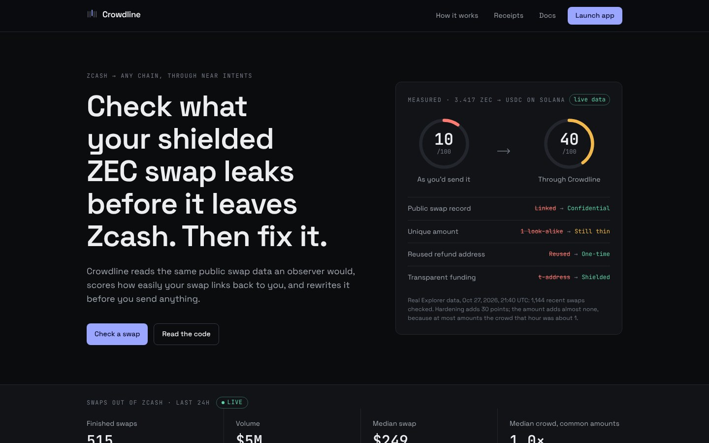
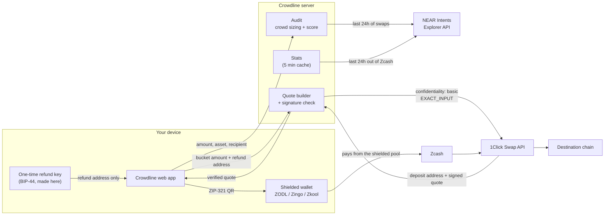
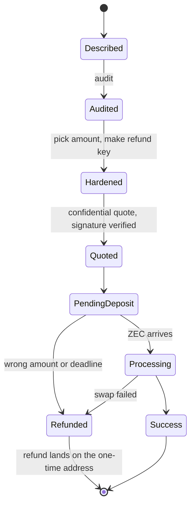
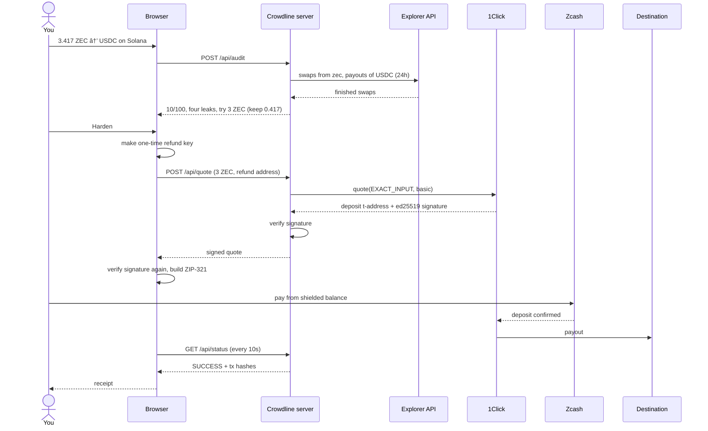
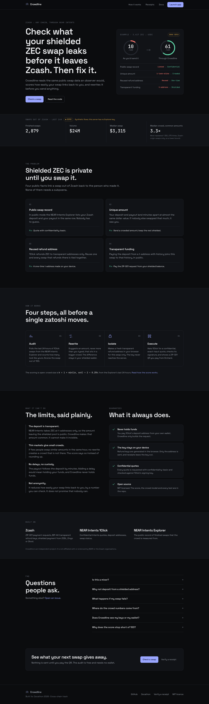
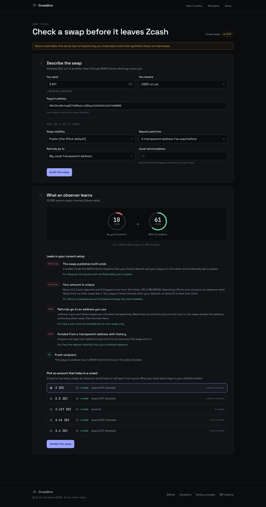
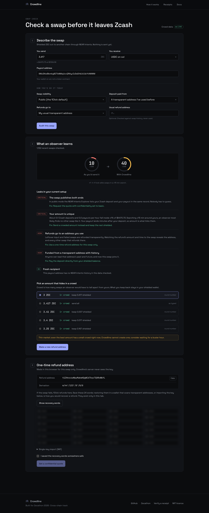

# Crowdline

[](https://github.com/softalpha0/crowdline/actions/workflows/ci.yml)

When you swap shielded ZEC to another chain through NEAR Intents, four public facts can tie the
swap back to you: the swap record, the amount, the refund address and the funding address.
Crowdline reads the same public data an observer would, counts how many recent swaps look like
yours, scores the swap out of 100, and rewrites it before anything is sent: a crowded amount, a
Confidential Intents quote, a one-time refund address made on your device, and a ZIP-321 request
you pay straight from your shielded balance. It never holds funds.

[](#crowdline)

- **Live app:** https://www.crowdl.site
- **Verified mainnet run:** [`evidence/`](evidence/)
- **Docs:** [threat model](docs/threat-model.md) · [scoring](docs/scoring.md) ·
  [architecture](docs/architecture.md) · [submission](docs/submission.md)

Built for [Zecathon](https://thezecathon.com), Cross-chain track.

---

## Contents

- [The problem](#the-problem)
- [What Crowdline does](#what-crowdline-does)
- [Try it in a minute](#try-it-in-a-minute)
- [How it works](#how-it-works)
- [The crowd model](#the-crowd-model)
- [One refund address, one swap](#one-refund-address-one-swap)
- [The swap lifecycle](#the-swap-lifecycle)
- [What Crowdline does, and what it never does](#what-crowdline-does-and-what-it-never-does)
- [Guarantees](#guarantees)
- [The verified mainnet run](#the-verified-mainnet-run)
- [Screens](#screens)
- [Tech stack](#tech-stack)
- [Running it yourself](#running-it-yourself)
- [Testing](#testing)
- [Project layout](#project-layout)
- [Known limitations](#known-limitations)
- [Roadmap](#roadmap)
- [Credits](#credits)

## The problem

Shielded ZEC is private until you swap it for something else. Most people leave Zcash through
NEAR Intents 1Click, and on the way out four things give them away:

1. **The public swap record.** In the default public mode, the NEAR Intents Explorer lists your
   Zcash deposit and your payout on the other chain in the same row. Nobody has to guess.
2. **The unique amount.** With that record hidden, your deposit and payout still land minutes
   apart at almost the same dollar value. If nobody else swapped about $4,430 in that window, it
   was you.
3. **The reused refund address.** 1Click refunds ZEC to transparent addresses only. Reuse one and
   every swap that refunds there is tied together. ZachXBT showed this in public with a static
   refund address in a wallet integration.
4. **Transparent funding.** Paying the deposit from a t-address with history joins the swap to
   that history.

All of it is public data. None of it needs a subpoena.

## What Crowdline does

| Step        | What happens                                                                                                                                         |
| ----------- | ---------------------------------------------------------------------------------------------------------------------------------------------------- |
| **Audit**   | Pulls the last 24h of finished 1Click swaps from the NEAR Intents Explorer and counts how many look like yours. Scores the swap and lists each leak. |
| **Rewrite** | Suggests an amount, never more than you typed, that sits in a bigger crowd. The difference stays in your shielded wallet.                            |
| **Isolate** | Makes a one-time transparent refund address in your browser. Its key never reaches the server.                                                       |
| **Execute** | Requests a 1Click quote with `confidentiality: "basic"`, exact input and the one-time refund, verifies 1Click's signature, and shows a ZIP-321 QR.   |
| **Prove**   | Tracks the swap to the payout and gives you a receipt with the before and after scores and the signed quote. `/receipt` verifies it later.           |

Around the swap itself:

| Feature             | What it does                                                                                                                                                 |
| ------------------- | ------------------------------------------------------------------------------------------------------------------------------------------------------------ |
| **When to swap**    | The same crowd model, hour by hour over the last three days (`GET /api/timing`), so you can see when swaps your size are common.                             |
| **Which route**     | Sizes the same swap on the destinations people actually leave Zcash for (`GET /api/routes`) and offers to switch.                                            |
| **Funding recency** | Asks when the funds entered the shielded pool. Money shielded minutes ago and sent straight out costs points and gets its own finding.                       |
| **Saved swaps**     | Encrypts an unfinished swap (recovery words, quote) with your passphrase, PBKDF2 and AES-GCM in the browser, so a closed tab no longer loses the refund key. |
| **Wallet guide**    | Step-by-step payment for ZODL, Zingo, Zkool and others, including why not to use ZODL's own CrossPay for this.                                               |
| **Refund recovery** | `/recover`: words or WIF in, a signed transparent sweep out. Built and signed in the browser; the server only relays the signed bytes.                       |
| **The way in**      | `/in`: another chain's asset to ZEC with a confidential quote, then shield it. Remembers when, for the recency check.                                        |
| **Backtest**        | Replays the observer against the last day of real swaps (`GET /api/backtest`) and shows how often a swap in each predicted crowd was linked with certainty.  |
| **Shared cache**    | With Upstash Redis or Vercel KV configured, Explorer reads and the 5-second Explorer turn are shared by every server instance.                               |

Measured on the live site against real Explorer data (Oct 27, 2026, about 21:40 UTC, 1,144 recent
swaps checked): a typical swap of 3.417 ZEC to USDC on Solana, in public mode with a reused refund
address and funded from a reused t-address, scores **10/100**. Through Crowdline it scores
**40/100**. Confidential mode, the one-time refund address and shielded funding add 30 points. The
amount adds almost nothing: that hour only about 0.08 Zcash deposits and 0.04 USDC-on-Solana
payouts per hour fell within ±1% of any one amount, so the best crowd was about 1. That is the
"thin market" limit, measured rather than assumed. The same 24 hours held 511 finished swaps out
of Zcash worth $4.96M, median $249 (`GET /api/stats`).

On the synthetic demo flows (no Explorer key) the same swap goes from 10 to 61, because the demo
market is busier than the real one.

## Try it in a minute

1. Open the live app (link above) or run it locally ([below](#running-it-yourself)).
2. **Check a swap.** Enter an amount, pick what you receive, paste the payout wallet address.
3. Say how you would send it today, then **Audit this swap**.
4. Pick an amount from the crowd list and **Harden this swap**.
5. Save the 24 recovery words for the one-time refund address and tick the box.
6. **Get a confidential quote.** Check the "Signed by 1Click" badge, scan the QR with ZODL, Zingo or
   Zkool, and pay from your shielded balance.
7. **Download receipt.** Load it on `/receipt` any time to re-verify the signature and the status.

Or from a terminal:

```bash
pnpm cli audit --amount 3.417 --to USDC:sol --recipient <address> --funding transparent-reused
```

## How it works

### Architecture



All scoring lives in `packages/core`. The server calls it; the web app renders what comes back
and never re-implements it. More detail: [docs/architecture.md](docs/architecture.md).

### Where NEAR Intents fits

Crowdline does not route funds. NEAR Intents does the swap, and Crowdline uses three of its
public interfaces:

- **1Click Swap API** (`/v0/tokens`, `/v0/quote`, `/v0/status`) for routes, prices, the deposit
  address and swap status. Every quote is `EXACT_INPUT` with `confidentiality: "basic"`, which
  1Click only accepts with a partner API key.
- **Confidential Intents** keep the deposit and payout out of a single public record, so an
  observer has to match them by amount and time. That is the gap the crowd model measures.
- **Explorer API** (`/api/v0/transactions`) for the finished swaps the crowd is counted from. It
  allows one request every five seconds; Crowdline queues and pages through it with
  `lastDepositAddress`.

1Click signs every quote with ed25519. Crowdline checks the signature on the server before it
replies and again in the browser before it shows the QR, using the same message construction as
the official SDK (`packages/oneclick/src/signature.ts`).

## The crowd model

For a swap worth `$usd` going to `destinationAsset`, Crowdline looks at the last 24 hours and counts:

- `inRate`: Zcash-origin swaps per hour with `amountInUsd` within ±1% of `$usd`
- `outRate`: swaps per hour paying out `destinationAsset` with `amountOutUsd` within ±1% of `$usd`

An observer who sees your deposit searches about ±15 minutes for a matching payout. The expected
number of swaps they cannot tell apart from yours, you included, is

```
k    = 1 + min(inRate, outRate) × 2 × 0.25
bits = log2(k)
```

You are only as hidden as the thinner side. The amount is worth up to 60 points
(`60 × min(1, bits / 5)`, full marks at k ≥ 32), a one-time refund address 15, shielded funding 15
(a fresh t-address 7) and a recipient with no swap history 10. A public-mode swap is capped at 10.

**Worked example** (the test fixture, pinned in `packages/core/test/score.test.ts`): 48 swaps of
exactly 1 ZEC ($300) went from Zcash to USDC in the last 24 hours.

| Step                     | Calculation                      | Result     |
| ------------------------ | -------------------------------- | ---------- |
| Deposits per hour in ±1% | 48 / 24                          | 2.0        |
| Payouts per hour in ±1%  | 48 / 24                          | 2.0        |
| Crowd                    | 1 + min(2.0, 2.0) × 2 × 0.25     | k = 2      |
| Bits                     | log2(2)                          | 1.0        |
| Amount points            | 60 × min(1, 1.0 / 5)             | 12         |
| Hardening points         | one-time refund 15 + shielded 15 | 30         |
| Recipient points         | no history                       | 10         |
| **Score**                | 12 + 30 + 10                     | **52/100** |

Full detail, including how buckets are chosen: [docs/scoring.md](docs/scoring.md).

## One refund address, one swap

1Click refunds ZEC to a transparent address, so the refund address is public, and a reused one
links every swap that ever refunds there. Crowdline makes a new one for every swap:

- A fresh 24-word BIP-39 phrase is generated in the browser with `@scure/bip39`.
- The key is derived at `m/44'/133'/0'/0/0` with `@scure/bip32` and encoded as a mainnet `t1`
  address (tested against an independent derivation).
- Only the address goes to the server and to 1Click. The phrase and the WIF key stay in the tab,
  hidden until you reveal them, and the page warns you before it closes mid-swap.
- The receipt is built from an allow-list (`buildReceipt`), so the key cannot end up in it; a test
  passes the full key object in and checks no two consecutive phrase words or the WIF appear.
- Quotes are `EXACT_INPUT` for exactly the amount you send, so a successful swap has nothing to
  refund. The address is only used if the swap fails.

To recover a refund, restore the phrase in a wallet that scans BIP-44 transparent addresses, or
import the WIF key, and shield the ZEC again.

## The swap lifecycle





## What Crowdline does, and what it never does

| Crowdline does                                               | Crowdline never                              |
| ------------------------------------------------------------ | -------------------------------------------- |
| Read public swap data from the Explorer                      | Hold, pool or route your funds               |
| Score your swap and say which leak costs what                | Ask for a wallet connection or a viewing key |
| Suggest an amount at or below what you typed                 | Suggest sending more than you typed          |
| Make a refund key in your browser                            | Send, log or store that key                  |
| Ask 1Click for a confidential quote and verify its signature | Show a quote whose signature fails           |
| Label demo data as demo, everywhere                          | Present synthetic flows as real swaps        |
| Say when the crowd is thin                                   | Add delays, which would mean holding funds   |

## Guarantees

| Claim                                      | How it is enforced                                                                 | Proof                                                                      |
| ------------------------------------------ | ---------------------------------------------------------------------------------- | -------------------------------------------------------------------------- |
| Never holds funds                          | You pay 1Click's deposit address from your wallet; the server only builds requests | `apps/server/src/app.ts` (no wallet code anywhere)                         |
| The refund key never leaves your device    | Generated in the browser; only the address is posted                               | `apps/web/src/pages/SwapApp.tsx`, `packages/core/test/refund.test.ts`      |
| Receipts never contain the key             | `buildReceipt` copies from an allow-list                                           | `packages/core/test/receipt.test.ts`                                       |
| Every quote is confidential                | `confidentiality` is always `basic` (or `advanced` if asked), never `public`       | `packages/oneclick/test/oneclick.test.ts`                                  |
| Quotes are checked against 1Click's key    | ed25519 over the SDK's message; server refuses, browser hides the QR on failure    | `packages/oneclick/test/signature.test.ts`, `apps/server/test/app.test.ts` |
| No refund on success                       | `EXACT_INPUT` for exactly the amount you send                                      | `packages/oneclick/test/oneclick.test.ts`                                  |
| Refunds go only to a transparent address   | `buildQuoteRequest` rejects anything that is not t1/t3                             | `packages/oneclick/test/oneclick.test.ts`                                  |
| Never suggests sending more than you typed | Buckets are capped at the requested amount                                         | `packages/core/test/crowd.test.ts`                                         |
| A public swap never scores above 10        | Cap in `auditIntent`                                                               | `packages/core/test/score.test.ts`                                         |
| Demo data is labelled                      | `mode: "demo"` on every response; badge and banner in the UI; field in receipts    | `apps/server/test/app.test.ts`                                             |
| API keys stay on the server                | Read from the environment in `apps/server` only                                    | `apps/server/src/data.ts`                                                  |
| The Explorer rate limit is respected       | One queue, 5.1s between calls, paging with `lastDepositAddress`                    | `packages/oneclick/test/oneclick.test.ts`                                  |

Threat model and what is out of scope: [docs/threat-model.md](docs/threat-model.md).

## The verified mainnet run

One real swap, made on the live site on Oct 27, 2026 and documented in [`evidence/`](evidence/)
with the receipt.

| Time (UTC) | Event                                                                                                                                              | Status            |
| ---------- | -------------------------------------------------------------------------------------------------------------------------------------------------- | ----------------- |
| 23:22:34   | Live audit (10 → 40), confidential quote, signature verified                                                                                       | `PENDING_DEPOSIT` |
| ~23:30     | 0.0015 ZEC paid from ZODL's shielded balance to `t1ZN3Ctg…Eyz6Mr`                                                                                  | `PROCESSING`      |
| 23:38:20   | [1.685932 USDC paid out on Solana](https://solscan.io/tx/5zbufqTqQNa1HLGUGrgZgWUDMCdgkGiVjDJb8mCdPHqCqH2BimvBNar9G8m688kkVMYPmGrzq9VkUYE4T8vsH7az) | `SUCCESS`         |

The swap was confidential: 1Click's public status endpoint answers "deposit address not found"
without a partner key. The executed quote is also a test fixture, and changing its deposit address
breaks the signature. The evidence page also records how the ZEC reached the shielded wallet (a
bridge from Solana shortly before), and the timing link that leaves.

A second run, on Oct 28, went the other way through `/in`: 1.8 USDC on Solana in, a confidential
signed quote, and 0.00116274 ZEC delivered to the ZODL wallet's transparent address, checked on
the Zcash chain through lightwalletd. It is written up as run 02 in [`evidence/`](evidence/).

Check it yourself:

```bash
curl -s "https://www.crowdl.site/api/status?depositAddress=t1ZN3CtgSe63JSfynA3jc1oTV46i3Eyz6Mr"
curl -s "https://1click.chaindefuser.com/v0/status?depositAddress=t1ZN3CtgSe63JSfynA3jc1oTV46i3Eyz6Mr"   # not found: confidential
```

```powershell
Invoke-RestMethod "https://www.crowdl.site/api/status?depositAddress=t1ZN3CtgSe63JSfynA3jc1oTV46i3Eyz6Mr" | ConvertTo-Json -Depth 6
```

## Screens

| Landing                                   | Audit                                     | Refund key                                  |
| ----------------------------------------- | ----------------------------------------- | ------------------------------------------- |
|  |  |  |

Phone (375px): [landing](docs/screens/landing-375.png) · [describe](docs/screens/app-describe-375.png) ·
[audit](docs/screens/app-audit-375.png) · [refund](docs/screens/app-refund-375.png) ·
[receipt](docs/screens/receipt-375.png). Screens show live crowd data, captured Oct 27, 2026.

## Tech stack

| Part            | Choice                                                                          |
| --------------- | ------------------------------------------------------------------------------- |
| Language        | TypeScript, strict, `noUncheckedIndexedAccess`                                  |
| Swaps           | NEAR Intents 1Click Swap API, Confidential Intents                              |
| Crowd data      | NEAR Intents Explorer API                                                       |
| Keys            | `@scure/bip39`, `@scure/bip32`, `@noble/hashes`, `@scure/base`                  |
| Signatures      | `@noble/curves` ed25519                                                         |
| Payment request | ZIP-321, QR via `uqr`                                                           |
| Web             | React 19, React Router 8, Tailwind CSS 4, Vite 8, self-hosted fonts             |
| Server          | Node `http`, no framework                                                       |
| Tooling         | pnpm workspaces, Vitest 5, ESLint strict type-checked, Prettier, GitHub Actions |
| Hosting         | Vercel: static site + one bundled Node function (`scripts/vercel-build.mjs`)    |

## Running it yourself

Requires Node 22.22 or newer and pnpm 10.

**PowerShell**

```powershell
git clone https://github.com/softalpha0/crowdline
cd crowdline
pnpm install
copy .env.example .env
notepad .env          # add your keys, or leave empty for demo data
pnpm dev              # API on :8787, app on http://localhost:5173
```

**bash**

```bash
git clone https://github.com/softalpha0/crowdline
cd crowdline
pnpm install
cp .env.example .env  # add your keys, or leave empty for demo data
pnpm dev              # API on :8787, app on http://localhost:5173
```

| Variable                               | Needed for                                                                                                                         | Where to get it                                                              |
| -------------------------------------- | ---------------------------------------------------------------------------------------------------------------------------------- | ---------------------------------------------------------------------------- |
| `EXPLORER_JWT`                         | Live crowd data. Without it the app runs on labelled demo flows.                                                                   | [partners.near-intents.org](https://partners.near-intents.org), Explorer key |
| `ONECLICK_API_KEY`                     | Confidential quotes. Without it the quote step is switched off.                                                                    | same, Distribution Channel key                                               |
| `KV_REST_API_URL`, `KV_REST_API_TOKEN` | Optional. Shares cached Explorer reads across server instances. `UPSTASH_REDIS_REST_URL` and `UPSTASH_REDIS_REST_TOKEN` also work. | Vercel Storage (Upstash for Redis), or upstash.com                           |
| `LIGHTWALLETD_HOST`                    | Optional. lightwalletd used by refund recovery. Default `zec.rocks:443`.                                                           | any public lightwalletd                                                      |

Production, any Node host: `pnpm build` then `pnpm start` serves the site and the API on one port
(`PORT`, default 8787).

Vercel: `pnpm build:vercel` writes `.vercel/output` (Build Output API): the site as static files and
`/api/*` as one Node function. Import the repo in Vercel, keep the settings from `vercel.json`, and
add `ONECLICK_API_KEY` and `EXPLORER_JWT` as environment variables.

## Testing

```bash
pnpm test     # 107 tests
pnpm check    # format, lint, typecheck, test
```

No test touches the network. Every 1Click and Explorer response is a recorded fixture or a fake
`fetch`. What the tests pin down:

- **Signatures:** a real dry quote and the executed confidential quote from the mainnet run both
  verify; changing the payout, recipient, refund address, deposit address or timestamp breaks
  them; malformed input returns false.
- **Keys:** transparent addresses match an independent derivation; a fresh 24-word phrase every
  time; `m/44'/133'/0'/0/0`; receipts never contain the phrase or WIF.
- **Amounts:** ZEC parsed to zatoshi without floating point; ZIP-321 requests carry no memo.
- **Crowd model:** lookback, band, thinner-side logic, buckets never above the requested amount,
  the README's worked example.
- **Score:** a public-mode swap never scores above 10.
- **Quotes:** `EXACT_INPUT`, `confidentiality`, zatoshi amounts, shielded refund addresses refused.
- **Explorer:** requests spaced 5s apart; pagination follows `lastDepositAddress`, stops at the
  window start, reports truncation.
- **Sweeps:** two real v6 mainnet transactions re-encode byte for byte, their txids match, and all
  their signatures verify under Crowdline's ZIP 244 / ZIP 229 digest; sweeps pay the ZIP 317 fee,
  use low-S signatures, pick v5 or v6 from the branch id, and refuse coins locked to another key.
- **Insights:** hour-of-day crowds, route ranking and the backtest on hand-built flows, including
  a payout pushed outside the band by fees.
- **Sessions:** a saved swap opens only with its passphrase, never stores the words in clear, and
  uses a fresh salt and IV each time.
- **Server:** `/api/stats` labels demo data and caches for five minutes; `/api/quote` refuses
  without a key, blocks a tampered quote, catches a wrong-chain payout address, and explains
  1Click's bare 500 and Explorer 429s; timing, routes and stats share one Explorer read; the
  inbound quote refuses shielded recipients; the broadcast endpoint relays transparent
  transactions only; the Upstash client speaks the REST protocol to a fake.

## Project layout

```
crowdline/
├── apps/
│   ├── web/          React site: landing, /app, /in, /recover, /receipt
│   ├── server/       API: config, stats, audit, quote, status, timing, routes, backtest,
│   │                 inbound/quote, refund/coins, refund/broadcast; shared cache; lightwalletd
│   └── cli/          crowdline audit | crowdline refund
├── packages/
│   ├── core/         crowd model, buckets, score, stats, insights, refund keys, sweeps
│   │                 (ztx), sealed sessions, ZIP-321, receipts
│   └── oneclick/     1Click + Explorer clients, quote builder, signature check
├── docs/             threat model, scoring, architecture, submission, screens
├── evidence/         mainnet receipts and transaction links
├── scripts/          vercel-build.mjs (Build Output API)
├── vercel.json       Vercel deploy
└── .github/workflows/ci.yml
```

## Known limitations

- **The deposit itself is transparent.** NEAR Intents only takes ZEC at t-addresses, so the amount
  leaving the pool is public. Crowdline makes it common; it cannot make it invisible.
- **Crowds can be thin.** If few people swap similar amounts, the best bucket may still be small.
  The score and the app say so.
- **No delay.** The payout follows the deposit by minutes. A delay would mean holding funds.
- **The landing-page crowd figure is a lower bound.** `/api/stats` only reads Zcash-origin swaps,
  so payouts that started on other chains are not counted there. The audit itself counts both.
- **Busy windows are undercounted.** The Explorer walk stops after six pages of 1,000 rows. That
  makes scores stricter, not looser, and `/api/stats` reports `truncated: true`.
- **1Click does not sign `confidentiality`.** The signature covers amounts, addresses and the
  deposit address, not the visibility setting, so the app shows that field as its own check.
- **Refund recovery is transparent to transparent.** `/recover` sweeps to a t-address; shield it
  in your wallet after. The signing code matches real mainnet transactions, but no sweep has been
  broadcast through the page yet, so start with a small refund.
- **The inbound flow pays a t-address.** 1Click delivers ZEC to transparent addresses only, so the
  arrival is public until you shield it.
- **The backtest observer is simple.** It matches by amount and time only, and places deposit and
  payout at the swap's creation time. A better-equipped observer can do more.

## Roadmap

Next, in order: an SDK so wallets can run the audit before their own swaps, a business model
through 1Click `appFees`, a public linkability index, and hosting fit for a privacy tool (onion
service, reproducible builds, IPFS mirror). Details: [docs/roadmap.md](docs/roadmap.md).

## Credits

- [NEAR Intents](https://docs.near-intents.org/) docs for 1Click, Confidential Intents, the
  Explorer API and quote signature verification.
- The Zcash community for [ZIP-321](https://zips.z.cash/zip-0321) and the transparent address
  format, and [ZODL](https://github.com/zodl-inc) as the reference shielded wallet.
- ZachXBT's public write-up of the static refund address leak, which this project answers.
- [paulmillr](https://paulmillr.com/noble/) for the noble and scure libraries.
- Space Grotesk (Florian Karsten) and JetBrains Mono, both under the SIL Open Font License, served
  via Fontsource.

Crowdline is independent and not affiliated with or endorsed by NEAR or the Zcash organisations.
MIT licensed.
