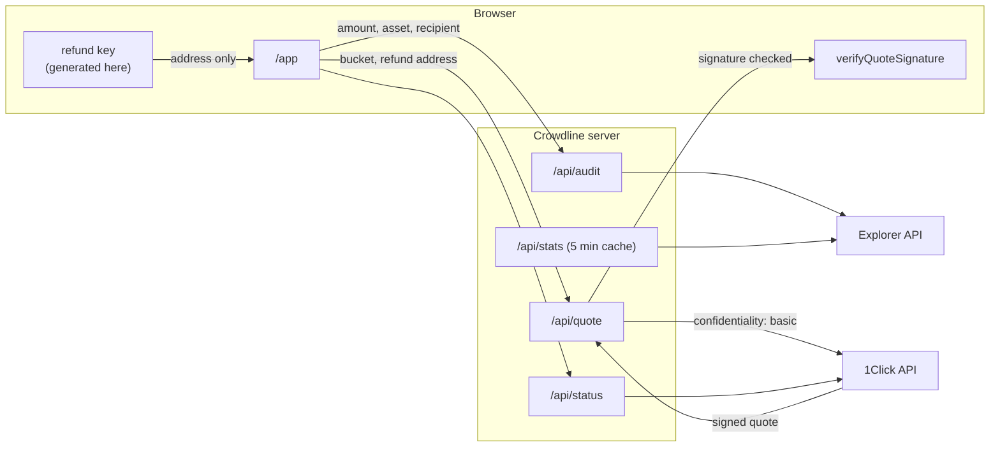

# Architecture

Crowdline is a pnpm workspace with two packages that hold all the logic and three thin apps on
top of them.

```
packages/core       pure TypeScript, runs in Node and the browser, no network
packages/oneclick   HTTP clients for 1Click and the Explorer, quote builder, signature check
apps/server         Node http: /api/*, serves the built site, keeps the API keys
apps/web            React 19 + Vite + Tailwind 4: landing, /app, /receipt
apps/cli            crowdline audit | crowdline refund
```

## Where each thing runs

| Concern                                   | Where                                       | Why there                                                              |
| ----------------------------------------- | ------------------------------------------- | ---------------------------------------------------------------------- |
| Crowd model, buckets, score               | `packages/core`, called by the server       | One implementation; the UI only renders the report                     |
| Explorer queries (rate limit, pagination) | `packages/oneclick` `Explorer`, on server   | Needs the Explorer JWT; one queue per server respects 1 request per 5s |
| 1Click quote request                      | `packages/oneclick` `buildQuoteRequest`     | Needs `ONECLICK_API_KEY`; confidential quotes require it               |
| Quote signature check                     | `packages/oneclick` `verifyQuoteSignature`  | Runs twice: on the server before replying, and again in the browser    |
| One-time refund key                       | `packages/core` `newOneTimeRefund`, browser | The key must never leave the device                                    |
| ZIP-321 request and QR                    | `packages/core` `depositRequest`, browser   | Built from the signed deposit address                                  |
| Receipt                                   | `packages/core` `buildReceipt`, browser     | Allow-list copy, so key material cannot be included                    |
| Landing-page stats                        | `packages/core` `swapStats`, server, 5 min  | One Explorer walk shared by every visitor                              |

## Request flow



## Secrets

`ONECLICK_API_KEY` and `EXPLORER_JWT` are read from the environment by `apps/server` only. No
route returns them, and the web bundle never references them. Without `EXPLORER_JWT` the server
runs on synthetic flows and every response says `mode: "demo"`; without `ONECLICK_API_KEY`
`/api/quote` refuses with a 503 rather than asking 1Click for a public quote.

## Rate limits

The Explorer allows one request per five seconds per key. `Explorer` keeps a promise chain and
spaces every call by 5.1s, across all routes. A crowd lookup is two queries (swaps from Zcash,
payouts of the destination asset), each up to six pages of 1,000 rows, cached for two minutes per
destination. `/api/stats` is one query, cached for five minutes.

## Hosting

On a single Node host (`pnpm start`) one process serves everything,
so the caches and the Explorer queue are shared by every visitor. On Vercel the site is static and
`/api/*` runs as one Node function (`apps/server/src/vercel.ts`, bundled by
`scripts/vercel-build.mjs`). Each warm instance keeps its own caches and queue, so under parallel
load two instances can each call the Explorer within five seconds; the server then reports the
Explorer's 429 in plain words instead of failing silently.

## Errors

`apps/server/src/app.ts` `explain()` maps upstream failures to messages a person can act on: an
Explorer 429, a rejected key, 1Click's bare 500 for a token-contract payout address, and network
failures. The browser shows them in place, next to the step that failed.
